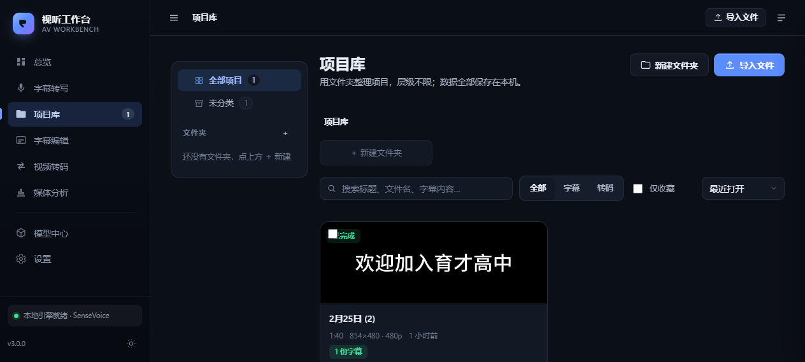

# 视听工作台 · AV Workbench


一个**双击即用**的本地音视频工具：把视频/音频变成可编辑的字幕，也能分析媒体信息、转码压缩。所有数据都保存在本机，断网可用。

> 单个 Go 可执行文件 + 内嵌网页 + 本地 sherpa-onnx 识别引擎。不需要装数据库，不需要上传素材，关掉浏览器也不会丢进度。



📖 **项目介绍页**：打开 [`site/index.html`](site/index.html)（项目亮点、痛点分析、下载与网页版入口，可直接部署到 GitHub Pages）。

---

## 为什么重新设计过

旧版是一个「命令行工具 + 简易网页」，用完即走。新版按**本地工作台**的思路重做：

| 维度 | 现在怎么做 |
|------|-----------|
| **更持久** | 每个文件导入后就成为一个「项目」，素材、字幕、成片、任务记录全部落盘；刷新、重启、断电都不会丢，索引损坏还能从目录自动重建。 |
| **更稳定** | 任务在后台队列里跑，浏览器只订阅进度；支持取消、失败重试、进程被杀后标记「已中断」；所有写文件操作都是「先写临时文件再改名」的原子写入。 |
| **更方便** | 拖拽导入 → 选预设 → 后台转写 → 直接进编辑器校对 → 导出。长音频自动分段，且尽量切在停顿处。 |
| **更专业** | 侧边栏工作台布局、时间轴可视化编辑、逐句时间码、批量平移/替换/去重叠、深色模式、实时命令预览、快捷键。 |
| **更傻瓜** | 自动探测 ffmpeg / Python / 模型；缺什么就在界面上给出可操作的修复建议；端口被占用自动换端口；启动后自动打开浏览器。 |

---

## 快速开始

### 1. 双击 `start.bat`

会做三件事：

1. 如果 `stt-sub.exe` 不存在，用 Go 自动构建（需要 Go 1.21+）；
2. 启动本地服务（默认 `http://127.0.0.1:8420`，端口被占用会自动换）；
3. 打开浏览器。

### 2. 准备环境（界面会告诉你缺什么）

| 组件 | 用途 | 怎么装 |
|------|------|--------|
| **ffmpeg / ffprobe** | 抽音、转码、分析 | 把 ffmpeg 解压到程序目录的 `ffmpeg\bin\`，或加入 PATH，或在「设置」里填路径 |
| **Python 3.10+（64 位）** | 本地识别引擎的运行环境 | <https://www.python.org/downloads/>，安装时勾选 Add to PATH |
| **sherpa-onnx** | 本地语音识别 | 双击 `setup_local_asr.bat` 自动安装 |
| **语音模型** | 真正做识别的模型 | 打开「模型中心」下载，中文推荐 **SenseVoice**（约 200MB，中/英/日/韩/粤，自带标点） |

> 全部就绪后，首页右上角会显示「运行环境 · 就绪」。也可以运行 `stt-sub.exe doctor` 在终端查看自检 JSON。

### 3. 开始使用

把文件拖到窗口里 → 自动导入为项目 → 选择字幕风格 → **开始转写** → 完成后点「打开字幕编辑器」边听边改 → 保存 / 导出 SRT。

---

## 功能地图

### 总览
导入入口、运行环境自检、资料库统计、最近项目、正在处理的任务。

### 字幕转写
- 识别模型与语言可选（默认自动）
- 四种字幕风格预设：均衡 / 短句 / 完整标点 / 逐句
- 输出 SRT / VTT / JSON
- 后台任务 + 实时进度 + 取消 + 失败重试
- 没有语音时会明确提示，而不是报错

### 项目库（资源管理器式）
界面与操作逻辑对齐 Windows 文件资源管理器：

- **左树定位**：快速访问（项目库 / 全部项目 / 最近使用 / 收藏）、智能视图（已完成 / 处理中 / 失败）、可无限嵌套的文件夹树、回收站；
- **三种视图**：详细信息（可点列头排序）、图标；底部状态栏显示项目数、选中数、总大小；
- **选择**：单击选中、`Ctrl` 加选、`Shift` 连选、空白处拖拽框选、`Ctrl+A` 全选、`Esc` 取消；
- **打开**：双击文件夹进入、双击项目打开详情；
- **文件操作**：剪切 / 复制 / 粘贴（跨文件夹，剪贴板在切换目录后仍有效）、拖拽移动到文件夹或左树、`F2` 重命名、`Delete` 移入回收站；
- **回收站**：可还原、彻底删除、一键清空；删除文件夹会连同子文件夹与其中项目一起移入；
- **右键菜单**：与资源管理器一致的分组（打开、剪切复制、重命名删除、属性），并显示快捷键；
- **搜索**：匹配标题、文件名、字幕内容与所在文件夹；在根目录搜索会扩展到全库；
- **导入**：点击「导入」或把文件从系统拖进窗口，导入后可直接归入当前文件夹；
- **详情窗格**：右侧显示所选项目的封面、状态、分辨率、字幕数、大小、位置等，可随时收起。

每个项目详情仍含六个页签：**字幕 / 媒体信息 / 成片与导出 / 附件 / 任务记录 / 备注**，可重命名、收藏、加备注、导入现成字幕。

| 快捷键 | 作用 |
|--------|------|
| `↑` `↓` | 移动选中项 |
| `Shift` + `↑` `↓` | 扩展选择 |
| `Enter` | 打开 |
| `Backspace` / `Alt+↑` | 上一级 |
| `F2` | 重命名 |
| `Delete` | 移入回收站（回收站内为彻底删除） |
| `Ctrl+X` / `Ctrl+C` / `Ctrl+V` | 剪切 / 复制 / 粘贴 |
| `Ctrl+A` / `Esc` | 全选 / 取消选择 |
| `Ctrl+Shift+N` | 新建文件夹 |
| `F5` | 刷新 |

### 播放页与「当前媒体」
- 项目详情、成片、附件里的「播放」都会打开站内播放页，而不是跳转到媒体地址看一段裸 JSON；
- 播放页支持视频/音频、原片与成片切换、字幕叠加、文件信息、快捷键（空格、← →、M 静音、F 全屏）；
- 源文件被移动或删除时，播放页会显示「源文件已丢失」并提供重新导入、返回项目等入口；
- 侧边栏新增「当前媒体」：最近打开的项目会一直保留，刷新页面、切换功能都不会丢；
- 字幕转写 / 视频转码 / 媒体分析 / 字幕编辑在未指定项目时会自动复用当前媒体，同一素材可以在几个功能之间来回切换。

### 字幕编辑器
- 播放器 + 时间轴 + 逐句列表联动
- 时间轴：拖动色块整体移位、拖两端改起止、点空白跳转、可缩放、重叠句自动分泳道
- 逐句：改文本、改时间码、按当前播放位置打「起/止」、从播放头拆分、插入、删除
- 批量工具：整体平移时间轴、查找替换、消除重叠、合并过短句
- 撤销 / 重做、未保存提示、Ctrl+S 保存
- 快捷键：空格播放暂停、↑↓ 上一句/下一句、Enter 下一句

### 媒体分析
容器信息、流明细（编码/分辨率/帧率/码率/声道/采样率）、浏览器可播性判断、原始 ffprobe JSON（可复制）。

### 视频转码
八个开箱即用的预设：网页通用 MP4、高画质 MP4、H.265 小体积、720p 适配、快速封装 MKV/MP4、只提取音频（M4A/MP3）。
展开高级参数可控制编码器、CRF、码率、分辨率、帧率、剪辑起止；**实时显示将要执行的 ffmpeg 命令**，转码后有进度、可取消，成片自动存进项目。

### 模型中心
已安装模型列表（含体积、语种、当前默认）、一键下载带进度、删除、设为默认。下载完成后下一次任务自动生效，无需重启。

### 设置
外观主题、识别引擎（本地 / 在线接口 / 命令行）、默认语言与模型、超时与分段长度、字幕排版与断句偏好、存储占用概览、环境自检详情。

---

## 数据放在哪

元数据（索引、设置、任务队列）与内容文件（素材、项目、成片）分开存放：
元数据小、需要事务与快速查询，放 SQLite；内容文件大，按项目目录组织，方便直接备份与用资源管理器查看。

> 仓库里只包含源码、文档与 `models/README.md`：`data/*.db`、`data/settings.json`、`project/`、`ffmpeg*/`、模型权重和运行日志都在运行期生成，已被 `.gitignore` 排除，克隆后首次启动会自动创建。

```
程序目录/
├── stt-sub.exe
├── start.bat
├── config.yaml            出厂默认配置（一般不用改）
├── models/                语音模型
├── data/                  元数据目录（小、可随时重建）
│   ├── library.db         SQLite：素材 / 项目 / 文件夹 / 项目集索引
│   ├── settings.json      界面设置
│   └── logs/              运行日志
├── project/               内容目录（大、可单独备份/迁移）
│   ├── assets/<xx>/<sha256><ext>   素材文件（按内容哈希去重）
│   ├── projects/<id>/              每个项目一个目录
│   │   ├── project.json            项目清单（可重建索引的权威来源）
│   │   ├── media/                  主素材的硬链接/副本
│   │   ├── subs/                   字幕（SRT / VTT / JSON）
│   │   └── out/                    转码成片与导出文件
│   ├── jobs/              任务记录、日志与中间产物
│   ├── temp/              上传缓存、缩略图、抽出的中间音频（自动清理）
│   └── trash/             回收站（彻底删除时才真正移除）
└── scripts/               sherpa_worker.py（本地识别常驻服务）
```

- **想换盘/放到别处**：在 `config.yaml` 里改 `general.project_dir`（内容目录）或 `general.data_dir`（元数据目录），
  留空时默认是「程序目录/data」与「程序目录/project」。启动时如果检测到旧版把素材放在 `data/` 里，会自动迁移到 `project/`。
- **备份/迁移**：`data/` 与 `project/` 一起复制即可；只想要作品时，单独备份 `project/projects/` 也能直接用。
- **索引损坏**：删掉 `data/library.db` 后重启，会扫描 `project/projects/*/project.json` 自动重建（素材仍按哈希复用）。
- 素材按 SHA-256 内容寻址，同一份文件导入两次不会占两份空间；同一文件在临时工作区重复导入也会复用已有项目。

---

## 架构

```
main.go            CLI 入口（serve / stt / info / transcode / models / doctor）
config/            YAML 配置加载与规范化
data/              数据目录、原子写、JSON 读写、路径安全
library/           项目库 + 素材库（索引可重建、内容去重）
jobs/              持久化任务队列（状态机、进度、日志、取消、重试）
pipeline/          转写流水线（探测 → 抽音 → 静音感知分段 → 识别 → 字幕）
adapters/          识别引擎适配层
  ├── local_engine.go   常驻 Python 子进程（sherpa-onnx），模型只加载一次
  ├── local_cli.go      任意命令行 STT 工具（whisper.cpp 等）
  ├── remote.go         OpenAI 兼容 HTTP 接口
  └── parse.go          JSON / SRT / 纯文本结果解析（含 GBK 兼容）
subtitle/          断句合并、折行、SRT/VTT/JSON 序列化、编辑操作
media/             ffmpeg 封装（探测、抽音、切片、转码、截帧、静音检测）
store/             模型商店（下载、解包、断点续传）
server/            HTTP API、SSE 任务事件、内嵌网页
scripts/
  └── sherpa_worker.py   常驻识别服务（模型缓存、VAD、分词级断句、进度回传）
```

### 为什么用常驻 Python 进程

旧版每段音频都重新启动一次 Python、重新加载模型，长音频会反复付出几秒钟的启动成本。
新版在第一次识别时启动一个常驻 worker，模型只加载一次，之后每段音频几十毫秒返回，同时还能把「正在识别第几段」的进度实时回传给界面。

### 稳定性设计

- 任务状态、进度、日志全部落盘；进程重启后历史任务仍在，正在跑的任务标记为「已中断」可重试。
- 写索引、写字幕、写设置都走「临时文件 + fsync + 原子改名」，Windows 上带重试。
- `library.db`（SQLite）丢失或损坏时，`Recover()` 会扫描 `projects/*/project.json` 重建索引。
- 上传先落盘再处理，超大文件不占内存；文件按 SHA-256 去重。
- ffmpeg 路径探测覆盖 PATH、程序目录、`ffmpeg*/bin`；找不到时给出具体放置建议。

---

## HTTP 接口（供脚本或二次开发）

| 方法 | 路径 | 说明 |
|------|------|------|
| GET | `/api/system` | 版本、数据目录、当前设置 |
| GET | `/api/system/check` | 环境自检（ffmpeg / Python / 模型 / 磁盘） |
| GET | `/api/stats` | 资料库统计、最近任务 |
| GET/POST | `/api/projects` | 列出（支持 `view` / `folderId` / `q` / `sort`）/ 创建项目 |
| GET/PATCH/DELETE | `/api/projects/{id}` | 项目详情 / 改名备注收藏移动到回收站 / 删除（`?permanent=1` 彻底删除） |
| POST | `/api/projects/{id}/subtitle` | 保存字幕（提交 cues 或字幕文本） |
| GET | `/api/projects/{id}/exports?format=srt` | 导出字幕 |
| GET | `/api/projects/{id}/probe` | 完整媒体信息 + 原始 ffprobe JSON |
| GET | `/api/projects/{id}/thumbnail?at=1` | 封面帧 |
| GET/POST | `/api/folders` | 文件夹树 + 各位置计数 / 新建文件夹（同名自动去重） |
| PATCH/DELETE | `/api/folders/{id}` | 重命名、移动、回收站还原 / 删除 |
| POST | `/api/folders/{id}/copy` | 深拷贝文件夹（含子文件夹与项目） |
| POST | `/api/library/batch` | 批量 `move` / `copy` / `trash` / `restore` / `delete` / `favorite` |
| POST | `/api/library/trash` | 清空回收站 |
| POST | `/api/ingest` | 上传文件并建立项目（multipart） |
| GET | `/api/assets/{id}/media` / `download` | 播放（支持 Range）/ 下载 |
| GET/POST | `/api/jobs` | 列出 / 创建任务（`transcribe` / `transcode`） |
| POST | `/api/jobs/{id}/cancel` / `retry` | 取消 / 重试 |
| GET | `/api/jobs/{id}/logs` | 任务日志 |
| GET | `/api/events` | SSE：任务状态变化推送 |
| GET | `/api/models` | 模型清单与安装状态 |
| POST | `/api/models/download` / `remove` / `select` | 下载 / 删除 / 设为默认 |
| GET/POST | `/api/settings` | 读取 / 保存设置 |
| POST | `/api/transcode/preview` | 生成 ffmpeg 命令预览 |

### 命令行（高级用法）

```bash
stt-sub serve -listen 127.0.0.1:8420 -open   # 启动工作台（默认行为）
stt-sub doctor                                # 环境自检
stt-sub stt -i input.mp4 -o out.srt           # 直接转写
stt-sub info -i input.mp4 -json               # 媒体信息
stt-sub transcode -i in.mp4 -o out.mp4 -resolution 720 -crf 23
stt-sub models list                           # 查看可下载模型
```

---

## 常见问题

**Q：识别结果出现乱码？**
旧版在 Windows 上用管道读取 Python 输出时会按 GBK 解码。新版 worker 强制 UTF-8（`PYTHONUTF8=1`），并对其它命令行工具的输出做了 GBK 回退解码。

**Q：提示「本地识别引擎还没准备好」？**
到「设置 → 关于与环境」查看具体缺什么：通常是 Python 位数不对、没装 sherpa-onnx，或还没下载模型。按提示处理即可，不需要重启。

**Q：长音频很慢 / 内存变高？**
在「设置 → 识别引擎」把分段长度调小（如 10 分钟）。程序按段送入模型，内存与单段长度相关，而不是整条音频。

**Q：端口 8420 被占用？**
启动时会自动改用其它端口，并在终端打印实际地址。

**Q：能完全离线用吗？**
可以。本地引擎与模型都在本机，转写、分析、转码都不联网；只有「在线识别接口」和「模型下载」需要网络。

---

## 开发

```bash
go test ./...        # 单元测试：字幕解析、项目持久化、任务状态机
go build -o stt-sub.exe .
```

- 前端是零依赖的原生 ES Module，源码在 `server/web/`，用 `//go:embed` 打进二进制。
- 修改前端后需要重新 `go build`（资源是内嵌的）。
- 想新增识别后端：在 `adapters/` 实现 `Transcriber` 接口并 `Register` 即可。

---

## 开源许可

本项目基于 [MIT License](LICENSE) 开源。第三方组件（ffmpeg、sherpa-onnx、模型等）遵循其各自的开源协议。

---

## 版本

当前 **3.0.0**。相对 2.x 是一次完整重做：项目库、任务队列、常驻识别引擎、时间轴编辑器、专业 UI、开箱自检。
